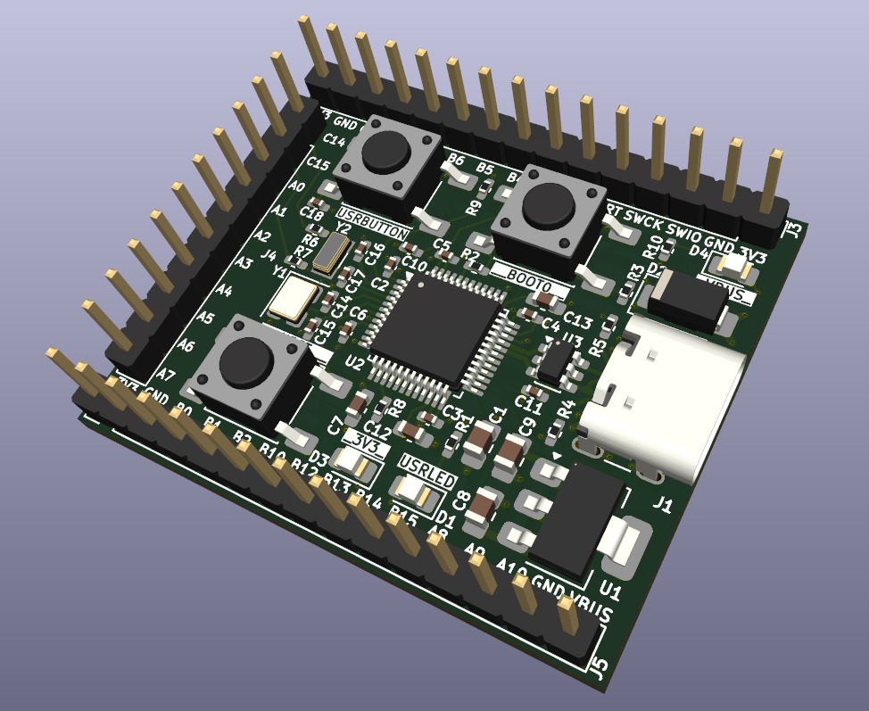
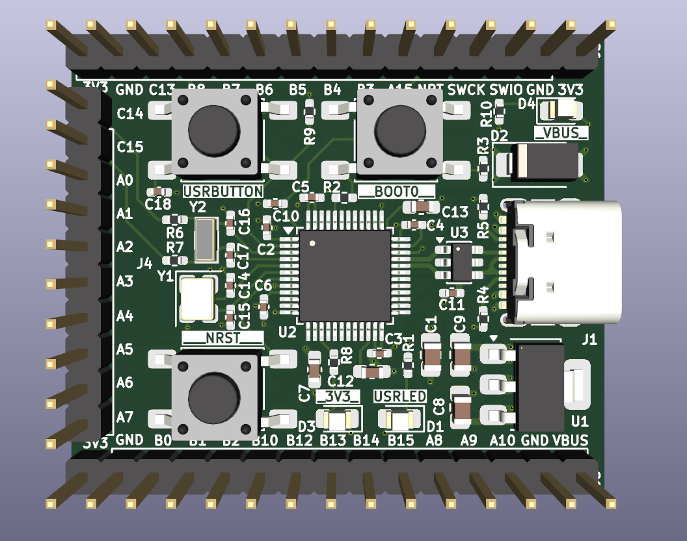

# m47Board-H503

## Custom PCB designed for STM32H503
- STM32C031C6T6 MCU
- USB-C port with ESD protection
- SWD and DFU programming interfaces
- Goldpin headers for all GPIO pins
- User Button and User Led
- RST and BOOT0 buttons
- TLV1117LV33DCYR 3.3V 1A LDO

## PCB Renders

